### ibi6

构筑看不见的管道。让想法自己长腿。

> 少依赖，少噪音，多一点锋利。

## Selected

| Project | Note |
| --- | --- |
| [ui-components-oss](https://github.com/ibi6/ui-components-oss) | Interface primitives, open-sourced |

## Craft

- Desktop instruments & quiet GUIs
- Services that stay out of the way
- Automation that prefers silence over ceremony

## Stack

`Python` `TypeScript` `JavaScript` `React` `Rust` `Node.js` `Docker` `Linux` `Git`

---

*Subtract until it works.*

