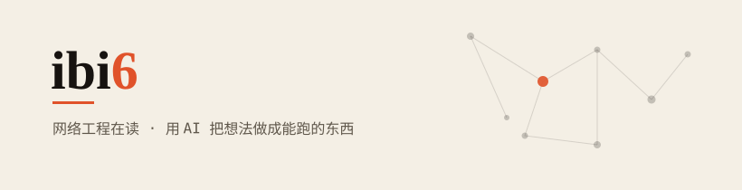

### 你好，我是 ibi6 👋

网络工程在读，喜欢用 AI 把脑子里的想法变成能跑起来的东西。桌面工具、Web 服务、自动化脚本都有在折腾——做得多、杂，但目标一致：把繁琐的变好用。

> 能上原生就上原生，能少一个依赖就少一个。

---

**🧰 在做的 / 折腾的**

- 桌面工具与 GUI（Python / Tauri）
- Web 服务与 API 中转
- 自动化脚本、浏览器与邮箱相关工具
- 前端页面（原生 HTML / CSS / JS 也能折腾）

**🌱 正在学**

- 网络工程专业课 + 计算机网络深入
- 借 AI 提效的全栈开发工作流

**⚙️ 工具 & 技术**

`Python` `TypeScript` `JavaScript` `HTML/CSS` `React` `Rust` `Node.js` `Git` `Docker` `Linux`

---

*把繁琐的，做成好用的。*

